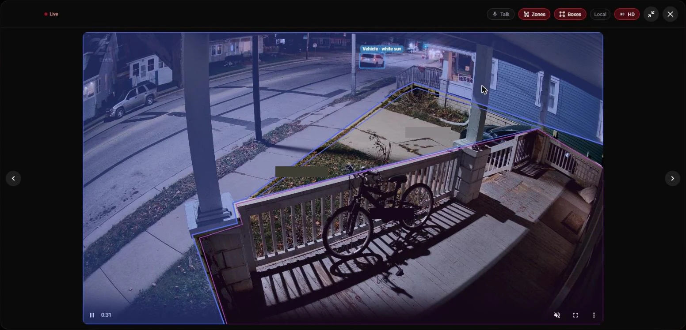

# Protect Tracker

Follows people, vehicles and animals on UniFi Protect cameras frame by frame, with a detector running
on your own machine, and tells Home Assistant where they are thirty times a second.

UniFi Protect's own live boxes arrive about four times a second and start a moment after something
comes into view. This project looks at every frame of the camera's stream itself: it sees a person
walking in within a tenth of a second, keeps one track on them from one edge of the picture to the
other, finds their face, and adds Protect's details (its type, description, zones, event) to the track
when Protect reports the same thing. Protect's detections, recordings and events are untouched; nothing
is written to Protect. UniFi Protect cameras only.



The boxes are drawn by Protect Detections' cards; camera and zone names are painted out.

<!-- SCREENSHOT: docs/tracking-local.png — Protect Detections' tracking card with source Local: a person
     walking up a path with the box on them and the face box on their face, the source mark showing "local".
     No house number, name or other identifying detail in the picture. -->

**Status: early, and in daily use on one camera.** The packets are drawn by
[Protect Detections](https://github.com/OnticEntia/protect-detections)' tracking card and camera wall;
this project has no card of its own.

## Contents

- [The parts](#the-parts) · [What you need](#what-you-need) · [Installing](#installing) · [Settings](#settings)
- [Two ways of working: Local and Auto](#two-ways-of-working-local-and-auto)
- [What is told, and when](#what-is-told-and-when) · [One person, one track](#one-person-one-track) · [Faces](#faces)
- [Frame rate](#frame-rate) · [What it costs](#what-it-costs) · [Models](#models)
- [Entities](#entities) · [Cameras that come and go](#cameras-that-come-and-go) · [For cards: the live command](#for-cards-protect_trackerlivesubscribe)
- [No footage is stored](#no-footage-is-stored) · [Looking into it](#looking-into-it) · [Development](#development)

## The parts

| Part | Where | What it does |
|---|---|---|
| Integration | `custom_components/protect_tracker` | The go-between inside Home Assistant. Hands the service each camera's stream and Protect's live reports, and passes what the service sees on to cards, a binary sensor and the sighting record. Holds no model. |
| Service | `service/` | A container next to Home Assistant. Reads the camera's video, runs the detectors, follows things. Uses a graphics card when there is one. |

Home Assistant connects to the service, not the other way round. The service has no login to Home
Assistant and none to Protect: it is handed a stream address (kept in memory while the camera is
watched, never stored or logged) and can do nothing but look at it.

## What you need

- Home Assistant 2026.3 or newer, with the built-in **UniFi Protect** integration set up.
- [**Protect Detections**](https://github.com/OnticEntia/protect-detections): Protect's live reports
  reach this project through it, and its cards are what draw the boxes.
- Somewhere to run a container next to Home Assistant. An NVIDIA graphics card (with the NVIDIA
  container toolkit) is strongly advised; every figure here is from an 8 GB RTX 3070. Without a card
  the service runs on the CPU and will not keep up with a 30-frame camera on anything but a small model.
- About 1–2 GB of memory for the service, and the model files (a few hundred MB; see [Models](#models)).

## Installing

Two things are installed, and HACS only does the first.

1. **The integration.** Add this repository to HACS as a custom repository (type: integration), install
   it, restart Home Assistant, and add "Protect Tracker" under Settings → Devices & services. Without the
   service it does nothing but wait for it.
2. **The service.** Clone this repository next to your compose file and add the service from
   [`service/compose.example.yaml`](service/compose.example.yaml) (or run it from there). It builds from
   `service/`, mounts a `models` folder read-only, runs with a read-only root filesystem (it has nothing
   to write), and listens on `127.0.0.1:8791` only. Home Assistant on host networking reaches it at
   `ws://127.0.0.1:8791/link`, which is the integration's default address.
3. **The models.** Put the model files in the `models` folder: see [Models](#models).
4. In the integration's options, switch on **Watch all the time** (see below).

<!-- SCREENSHOT: docs/options.png — the integration's options dialog: service address, camera stream,
     "Watch all the time". -->

## Settings

### The integration (Settings → Devices & services → Protect Tracker → Configure)

| Option | Default | |
|---|---|---|
| Tracking service address | `ws://127.0.0.1:8791/link` | Where Home Assistant reaches the service. |
| Camera stream to follow | Medium | Which of a camera's streams the service reads. Medium (1280×720) is what everything here was measured on. |
| Watch all the time | off | On: every camera that recognises things is watched always, whether or not Protect has reported anything. This is what lets the service see someone before Protect does; Local mode and the "Person seen" sensor want it on. Off: a camera is only watched from the moment Protect reports something on the move until half a minute after the last movement. |

### The service (environment variables)

| Variable | Default | |
|---|---|---|
| `TRACKER_MODEL` | `m` | The YOLOX size: `nano`, `tiny`, `s`, `m`, `l`, `x`. |
| `TRACKER_MODELS` | `/models` in the container | The models folder. |
| `TRACKER_MIN_FPS` | `20` | The frame-rate floor (see [Frame rate](#frame-rate)). Can be raised, not lowered. |
| `TRACKER_FAR` | `1` | `0`: without the sharp look (the picture at twice the size). |
| `TRACKER_FAR_EVERY` | `1` | The sharp look on one frame in this many. |
| `TRACKER_FACES` | `1` | `0`: no faces. |
| `TRACKER_IDLE_EVERY` | `1` | While nothing moves, look at one frame in this many. `1` is every frame, always. More is only taken as far as the floor allows. |
| `TRACKER_HOST`, `TRACKER_PORT` | `0.0.0.0`, `8791` in the container | Where the service listens. Publish the port on `127.0.0.1` only: there is no login. |
| `TRACKER_LOG` | `INFO` | Log level. |

## Two ways of working: Local and Auto

A card asks for one or the other (`mode` on the live command; Protect Detections' cards have a source
setting for it).

**Local: the service is the authority.** It tells what it sees as soon as it is sure, under its own
track ids, whether or not Protect has reported anything, and goes on when Protect is silent or its feed
is down. When Protect reports the same thing, Protect's details are added to the track already in
flight (its track id, type, description, zones, lines, event) and stay with it; the track is then
*confirmed*. Nothing of Protect's own is passed on in this mode.

**Auto: Protect is the authority, the service refines.** Only what Protect reports is shown, under
Protect's track ids. Where the service follows the same thing, its box for every frame takes the place
of Protect's four a second; where it does not (parked cars, kinds it has no model for, things small and
far off, or when the service is not running) Protect's own box is what is shown. A track has one box at
a time: Protect's is held back while the service's is fresh, and returns when the service has had none
for 0.7 s.

## What is told, and when

In Local mode nobody vetoes the service, so being sure is its own job.

| What | Told when |
|---|---|
| A person near the camera (at least 8% of the picture's height) | At once: found three frames running (a tenth of a second) at 75% or surer, moving or not. Someone walking into the picture is told at its edge. |
| A person the detector is less sure of (45–75%) | Once seen walking: found in most frames for a quarter of a second, going somewhere step by step. |
| A person small and far off (under 8% of the picture's height) | Once they have walked their own height from where they were first found. At that size a post or a pillar passes for a person, even surely for a frame or two. |
| A vehicle or an animal | Found for a quarter of a second, at 50% or surer and big enough (a vehicle at least 6% of the picture's height), having travelled half its own size from where it was first found, and on the move. |

What is never told:

- **Parked things.** A vehicle that only stands there (a car at the kerb, a bike on a porch) is not
  told, however its box shifts when something passes in front. The service remembers where things
  stand, from what Protect calls stationary and from its own eyes (four seconds in one place), for a
  minute after they were last found there. A parked car that drives off is told once it has left its
  place; a car that comes to rest in one is left out again until it moves.
- **Fixtures.** A "person" that has stood in one place for four seconds without ever being surely found
  is remembered as a fixture and not told.
- **A vehicle gone small into the distance** (under about 4% of the picture's height).

A track told is told until it ends. A person standing still stays told.

## One person, one track

A person is what is hidden most and changes shape most, so a person is held on to harder than anything
else:

- **Kept while hidden.** A person not found is kept for three seconds (not the half second other things
  get), unless they were at the picture's border: then they have left. In Local mode their box is shown
  where they should be for a second and a half of that; the id is held for all of it.
- **Known again.** A person-sized box found near where they were is the same person: nearer the
  sooner, further off the longer they were out of sight, reckoned in their height. Coming out from
  behind a post as a sliver, bent over a parcel, found as their top half one moment and the whole of
  them the next: still them.
- **Never two boxes for one.** The top half of someone found beside the whole of them is dropped, and
  an unsure box right beside someone already found starts no second track.
- **Two people stay two.** People side by side or passing each other each keep their own track.

The limit: someone out of sight for longer than three seconds comes back as a new track, and someone
else appearing close to where a person vanished, within those three seconds, is taken for them. There
is no recognising people by their look.

## Faces

Faces are looked for on the people found (up to three people a frame, the biggest in the picture), in
the square round each one's head. A face is a track of its own, tied to its person:
`<the person's track id>:face`, with `of` naming the person.

The face detector does not find a face in every frame. Between finds the face box is carried along with
its person, so it moves at the person's rate; a find corrects it, and after a second without one it is
given up. `held` on the track says which a box is. Faces are found, not recognised: nothing says whose.

## Frame rate

Every frame the camera sends is looked at. Whatever happens, a watched camera has at least **20 frames
a second** looked at (`TRACKER_MIN_FPS`). When the detector falls behind (more cameras, a card busy with
something else), the extras give way first, judged by how long a frame has waited since it came:

| A frame that has waited | Gives up |
|---|---|
| over 0.06 s | the sharp look: the ordinary one stands in |
| over 0.2 s | the faces |
| over 0.3 s | may be let go unlooked, while the rate stays above the floor |
| over 1 s | is let go: catching up comes first |

If the floor still cannot be held, that is said: every packet carries `fps` (frames looked at a second),
`fpsFloor` and `fpsOk`, and `protect_tracker/status` has the same per camera, with counts of what was
left out.

### The sharp look

The detector is made for a picture 640 across. Where the models folder also has its copy for a picture
twice as wide (`wide1280/`), the service looks at that instead: everything is four times the pixels,
which finds people far off and puts a tighter box on everything else. It takes about three times as
long, which one camera has room for on every frame.

## What it costs

On an RTX 3070 (8 GB), YOLOX-m, a 1280×720 H.265 stream at 30 frames a second.

| | Figure | |
|---|---|---|
| An ordinary look (640 across), whole pipeline | 8.6 ms | measured |
| A sharp look (1280 across), whole pipeline | 24.5 ms | measured |
| Finding faces, on a frame with a person | about 8 ms | measured |
| One camera, sharp look on every frame | 30 frames a second, about 50% of the card, about 700 MB of its memory | measured |
| One camera: the service's CPU and memory | about one core; 1–2 GB | measured |
| Two cameras, sharp look on both | both at 30 frames a second, 84–95% of the card, 1.2 GB | measured with a stand-in second camera in a process of its own, for a minute |
| Two cameras in the one service | every frame of both looked at; the sharp look gives way to the ordinary one on many frames of one of them | simulated from the measured times |

Two cameras fit, with little to spare. A smaller model at 1280 (YOLOX-s: 14–18 ms a look) leaves room
for the sharp look on both.

### Which model

Twelve combinations compared on 240 frames of a street at night (`/bench`, see below): how many of the
vehicles found by the biggest model at the biggest size each one also found. No people were in those
frames, and agreement with the biggest model is not the same as being right.

| Model | 640 across | 1280 across |
|---|---|---|
| nano | 19% in 11 ms | 60% in 11 ms |
| tiny | 30% in 12 ms | 68% in 14 ms |
| s | 41% in 5 ms | 67% in 18 ms |
| m | 55% in 7 ms | 73% in 25 ms |
| l | 54% in 12 ms | 82% in 31 ms |
| x | 57% in 19 ms | the yardstick, 47 ms |

The size of the picture matters more than the size of the model: near things are found by all of them,
far things only at 1280.

## Models

The model files are not part of this repository. The service reads them from the models folder:

```
models/
  yolox_m.onnx            the detector as published (any of nano, tiny, s, m, l, x)
  face_yunet.onnx         the face detector
  fast/yolox_m.onnx       made from the first: half precision, 640 across, for the graphics card
  wide1280/yolox_m.onnx   made from the first: half precision, 1280 across, for the sharp look
```

| Model | For | Licence | Where from |
|---|---|---|---|
| YOLOX | people, vehicles, animals | Apache-2.0 | the ONNX files on the YOLOX project's releases page, saved as `yolox_<size>.onnx` |
| YuNet | faces | MIT | the face detection model in OpenCV's model zoo, saved as `face_yunet.onnx` |

They run through ONNX Runtime (MIT), with its usage reporting switched off. The two copies are made
once, on any machine with Python (`pip install onnx numpy`):

```
cd service
python -m tools.make_fast_models ../models                                  # -> models/fast/
python -m tools.make_fast_models ../models --width 1280 --out wide1280      # -> models/wide1280/
```

Without `fast/` the published file is used as it is (slower); without `wide1280/` there is no sharp look.

## Entities

| Entity | |
|---|---|
| **Person seen** (binary sensor, one per camera, on the camera's own device) | On while the service itself sees a person on that camera: as a rule before Protect reports one, and also for people Protect never reports. Attributes: `count`, and `confirmed` (Protect has reported the same person meanwhile). Off a few seconds after the last sight of them. Needs "Watch all the time". |

Use it as a trigger in your own automations where being early matters more than being certain.
Protect's own detections remain the certain ones.

Where Protect Detections keeps its record of sightings, what the service sees is handed to it as well
(boxes, kinds and times only), so "last seen" includes people Protect never reported.

## Cameras that come and go

Which cameras there are is checked against Protect every two seconds, so none of this needs a restart
of Home Assistant or of the service.

| What happens | What is done |
|---|---|
| **A camera goes offline** (Protect still has it, but says it is not connected) | The service is told to stop watching it; nothing is tried while it is away. Its sensor is unavailable. Listeners are sent `{"status": "offline", "reason": "offline"}`. When Protect says it is connected again it is watched again by itself, and listeners are sent `{"status": "online"}`. |
| **Its stream cannot be read** although Protect says the camera is connected | The service tries again after 1 s, then 2, 4 … up to once a minute, for as long as it is to be watched. After 10 s without video it says so once (`stream: "down"` in the status, one line in its log) and once more when it is back; the tries in between are not logged. Listeners are sent `{"status": "offline", "reason": "stream_down"}` and then `online`; the sensor is unavailable meanwhile. |
| **None of its camera entities is enabled** in Home Assistant | There is no stream to be had: it is not watched (`no_stream`), its sensor is unavailable, and Auto still passes Protect's own boxes on. Enabling an entity again takes it up again. |
| **A camera is removed from Protect** | Once it has been missing for ten seconds: the service is told to stop for good (the stream is closed, and its thread, tracks and rates are dropped), everything held of it in Home Assistant is dropped, listeners are sent `{"status": "removed", "error": {"code": "camera_removed", ...}}` and their subscriptions are ended, and its sensor is removed. Nothing is ever tried for it again. |
| **A camera is adopted** | It is taken up within seconds: its sensor is made, and it is watched (at once with "Watch all the time", else from Protect's first report of something moving). |
| **The UniFi Protect integration is reloading** or cannot be asked | Nothing is concluded from that at first. If it lasts a minute, every camera counts as offline until it is back; none is ever removed on that account. |
| **A camera is restarted** (its clock starts over) | The service notices on the first frame after the stream is back, and starts following afresh under new track ids. |

When a camera is removed, the UniFi Protect integration removes the camera's device, and the "Person
seen" sensor goes with it (if the device is left for some reason, the sensor removes itself). A camera
adopted again later gets a new sensor.

The service holds a camera only from "watch" to "sleep", and drops every camera when Home Assistant's
connection closes, so nothing in it outlives the Home Assistant that asked for it; a service that still
holds a camera Home Assistant no longer watches is told to let it go the next time it reports.

The frame-rate floor is kept per camera: each watched camera has its own count, made when it is watched
and dropped with it, so a camera leaving or joining changes nothing in another's figures except what
sharing the card really costs. The frames a stream sends at once when it is opened again are caught up
with and not counted as falling behind, and a camera sending nothing is not called "below the floor".

Not handled here: a PTZ camera turned to another view is still the same camera, connected and
streaming, so none of the above applies to it; what the tracker should make of a changed view (things
remembered as parked, fixtures) is separate work and is not built yet.

## For cards: `protect_tracker/live/subscribe`

    {"type": "protect_tracker/live/subscribe", "entity": "<a UniFi Protect camera entity>", "mode": "local" | "auto"}

`mode` is optional (`auto`). Messages have the shape of Protect Detections'
`protect_detections/live/subscribe`: `clockWall`, `clockStream`, `clockStreamRate`, `eventId`, and
`tracks[]` with `id`, `coord` ([x, y, w, h] in 0–1000 of the whole picture), `objectType`, `confidence`
(0–100), `stationary`, `zones`, `loiterZones`, `lines`, `desc`. The first message is
`{"status": "connected", "mode": ..., "service": true | false}`.

Boxes are **stamped as Protect stamps its own** (a little after the frame they belong to), so a card
times them exactly as it times Protect's and needs no change for it.

Later status messages, in both modes: `{"status": "offline", "reason": "offline" | "stream_down" |
"no_stream"}` and `{"status": "online"}` as the camera goes and comes back (one who subscribes while it
is away is sent `offline` right after `connected`), and `{"status": "removed", "error": {"code":
"camera_removed", "message": ...}}` when the camera is taken out of Protect, after which the
subscription is ended from this side. See [Cameras that come and go](#cameras-that-come-and-go).

Errors: `not_loaded`, `not_found` (not a UniFi Protect camera), `not_ready` (the camera is not one
that is followed: it does not recognise things, or has just been removed; Local: the service is not
connected; Auto: Protect's reports are not coming). An integration too old to know `mode` refuses it as
`invalid_format`; without this integration the command is unknown.

### On every packet with boxes

| Field | |
|---|---|
| `mode` | `"local"` or `"auto"` |
| `source` | Auto: how the camera is being served just then, and it stays put: `"local"` while the service is watching it, `"protect"` while it is not. Local: always `"local"`. |
| `fps`, `fpsFloor`, `fpsOk` | Frames looked at a second, the floor, and whether it is being held (on the service's packets). |

### On every track

| Field | |
|---|---|
| `local` | `true` for a box found by the service, `false` for one of Protect's own (Auto only). |
| `moving` | The service's own view, on its own tracks only: `true` when the middle of the box is at least a hundredth of the picture (across and down together) from where it was a second before, or at the start of the track if that is less than a second ago. Faces: `true`. |
| `stationary` | Protect's word, passed on as Protect said it (Local: `false` until Protect's details are attached). |

### Local mode

| Field | |
|---|---|
| `id` | The service's own track id (starts with `L`), the same for the life of the track, never used again. |
| `confirmed` | `false` while only the service has seen the thing; `true` from the moment Protect reports the same thing, and for the rest of the track. |
| `protectId` | Protect's track id once confirmed, else `null`. |
| `objectType`, `confidence` | The service's (person, vehicle, animal, face) until confirmed, Protect's after. |
| `desc`, `zones`, `loiterZones`, `lines` | Empty until confirmed, then Protect's, kept as last reported. |
| `eventId` | Per track: the Protect event its track was reported under, else `null`. |
| `held` | On faces: `true` when the box was carried along with the person, `false` when found in that frame. |
| `of` | On faces: the person's track id. |

Every field is there on every track, empty rather than missing.

- **Every packet is the whole picture** (`snapshot: true`): a track that is not in a packet is gone.
- **Quiet is told from dead.** With nothing to tell, an empty packet says so about once a second.
  Silence for a few seconds means the camera is not being served. The service's connection going and
  coming back is also said: `{"status": "disconnected" | "connected", "mode": "local"}`.
- **Clocks.** `clockStream`, which is what the picture is matched with, is exact from the first packet.
  `clockWall` is the service's own estimate until Protect has reported something, and is then brought
  to Protect's clock gradually: it never jumps and never runs backwards.

### Auto mode

Tracks carry Protect's ids. The service's boxes have `local: true` and Protect's details. The face of a
person being followed, where the service finds one and Protect reports none, is a track of its own
(`<Protect's person track id>:face`, `of`): the one thing sent in Auto that Protect did not report.

### `protect_tracker/status`

Is the service reached, which cameras there are (`cameras`) and how each stands (`states`: `watching`,
`asleep`, `offline`, `stream_down` or `no_stream`), what is watched, and per watched camera: how its
stream is (`stream`: `open`, `opening` or `down`, with `error`, `down_s` and `retry_s`), the frame rate against the floor and what was
left out, look times, how many of Protect's moving tracks are followed and why bindings were let go, a
picture check (how much movement the service's boxes hold against Protect's), how far ahead of
Protect's first report the service had each thing, and how many face boxes were found or carried.

## No footage is stored

This project never writes video or pictures to disk: no recordings, no clips, no buffer files, no saved
frames. A frame lives in memory for as long as it takes to look at it. Your console already records
everything; keeping a second copy elsewhere would only be one more place for footage of your home to
sit. Anything that needs the past reads it from the console's own recordings, through Home Assistant,
in memory.

What is kept is derived data only: boxes, tracks, timings, ids and measurements. No face pictures and
nothing by which a face could be recognised.

## Looking into it

Three tools, all of which keep numbers only.

**Replay** puts a stretch of the console's recording through the detector and tracker as if it were
live, to see what the tracker makes of it: each person's track from when to when, and for each time one
track ended and another began, what was going on. This is how tracking faults are looked into. The
recording is asked for through Home Assistant, held in memory and dropped.

```
cd service
HA_URL=http://homeassistant.local:8123 HA_TOKEN=<a long-lived token> \
  python -m tools.replay --models ../models --camera 0 \
    --start 2026-01-31T21:17:30Z --end 2026-01-31T21:18:30Z
```

`--both` also runs the tracker as it was before people were held on to, for comparison. Protect's own
live reports cannot be replayed (the console keeps no history of them), so this is the tracker on its
own word.

**Model comparison** (`/bench` on the service's port) keeps a few hundred frames of whatever camera is
being watched in memory, runs every model in the models folder on them at both picture sizes, and says
for each how long a look takes and how its findings compare with the biggest model's.

```
curl -X POST "http://127.0.0.1:8791/bench?frames=240&every=15"    # start
curl http://127.0.0.1:8791/bench                                   # how far it is, and the numbers when done
```

**Alignment** (`python -m tools.spike`) stands in for the service and measures how the detector's boxes
line up in time with Protect's reports. Protect stamps a report about an eighth of a second after the
frame it describes (measured: 125 ms on the main stream, about 115 ms on the medium one).

## Development

```
python -m venv .venv && . .venv/bin/activate
pip install "onnxruntime-gpu[cuda,cudnn]" numpy av aiohttp pytest
pytest tests                             # the service: plain Python, no models or card needed
pytest tests_ha -o asyncio_mode=auto     # the integration: where Home Assistant and
                                         # pytest-homeassistant-custom-component are installed
```

The tests use a made-up camera (frames encoded, cut into RTP packets and served over RTSP) and made-up
scenes; several are shaped after what replays of real recordings showed, with no footage in them.

## Licence

MIT.
